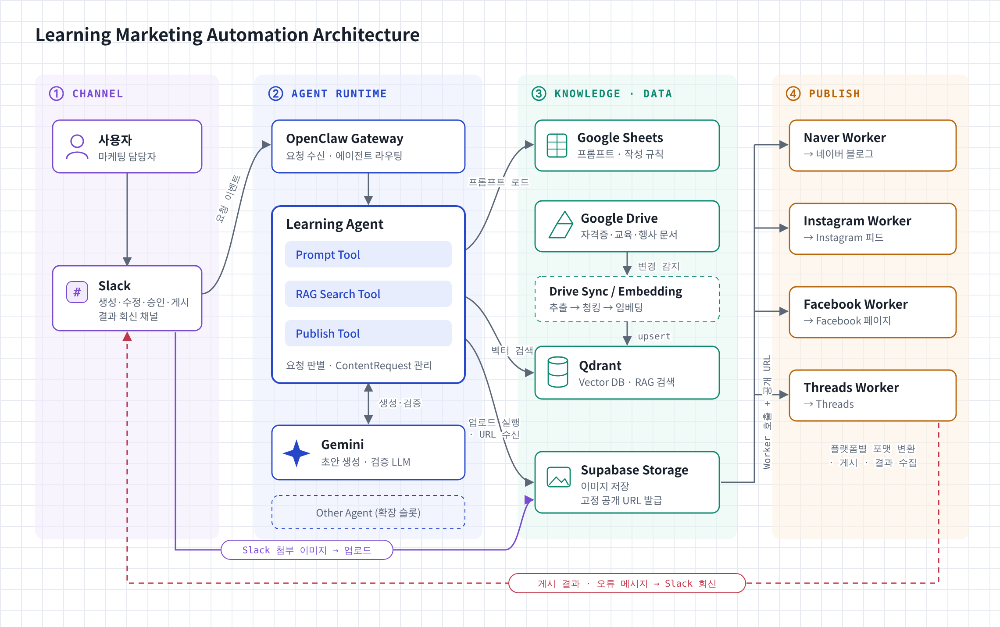
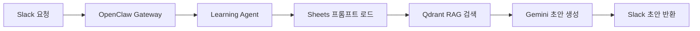
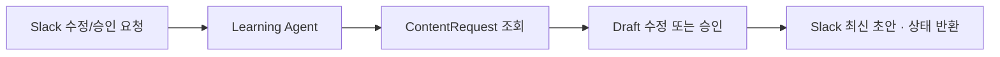
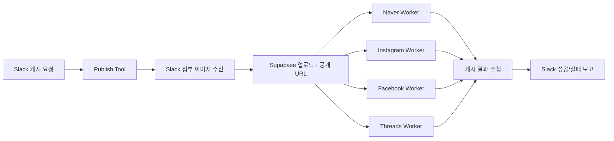
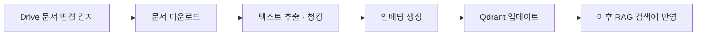

# Learning Marketing Automation Agent

Slack에서 요청을 받으면 OpenClaw 기반 **Learning Agent**가 Google Sheets 프롬프트와 Qdrant RAG 검색을 활용해 Gemini로 마케팅 콘텐츠 초안을 생성하고, Supabase 공개 URL로 이미지를 준비한 뒤 플랫폼별 Worker가 네이버 블로그 · Instagram · Facebook · Threads에 게시합니다. 게시 결과는 다시 Slack으로 회신됩니다.

**Stack** - Slack · OpenClaw Gateway · LangGraph · GeminiAPI · Google Sheets / Drive · Qdrant · Supabase Storage · Publish Workers ×4

## 1. 전체 시스템 구성도

| 레이어 | 구성 요소 |
|---|---|
| ① Channel | 사용자, Slack |
| ② Agent Runtime | OpenClaw Gateway, Learning Agent (Prompt Tool · RAG Search Tool · Publish Tool), Gemini, Other Agent(확장 슬롯) |
| ③ Knowledge · Data | Google Sheets(프롬프트 · 작성 규칙), Google Drive(배경지식 문서), Drive Sync / Embedding, Qdrant(Vector DB), Supabase Storage(이미지 · 공개 URL) |
| ④ Publish | Naver / Instagram / Facebook / Threads Worker |

- Slack 첨부 이미지는 Supabase Storage에 업로드되고, Publish Tool이 업로드를 실행해 공개 URL을 받아 Worker에 넘깁니다.
- 게시 결과와 오류 메시지는 Slack으로 회신됩니다.

## 2. 요청 유형별 처리 흐름

Learning Agent는 Slack 요청을 아래 네 가지 workflow 중 하나로 분기합니다.

### A. 콘텐츠 생성

새 마케팅 콘텐츠 초안을 만듭니다.

### B. 수정 · 승인

기존 요청에서 필요한 Draft만 갱신합니다.

### C. 게시

승인된 콘텐츠를 4개 플랫폼에 배포합니다.

### D. 지식 동기화 (백그라운드)

배경지식 문서를 벡터DB에 반영합니다.

